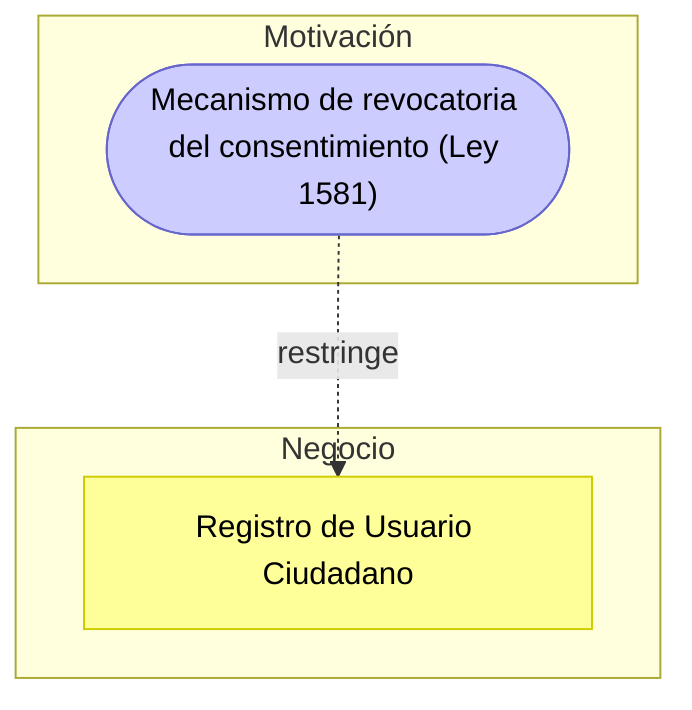

# Guía Paso a Paso: Checklist de Cumplimiento Normativo

Esta guía complementa el `README.md` del taller. Su objetivo es que, antes de evaluar el cumplimiento normativo de GobData en clase (Parte 1) o del sistema del cliente real (Parte 2), el equipo tenga una referencia clara de qué exige cada marco y de la metodología para pasar de "marcar casillas" a un diagnóstico legal priorizado.

---

## 1. Marcos normativos de referencia

| Marco / Norma | Qué exige (resumen) | Aplica cuando... |
|---|---|---|
| Habeas Data (Ley 1581 de 2012 - Colombia) | Autorización previa, expresa e informada; finalidad del tratamiento; derechos del titular según el artículo 8: conocer, actualizar y rectificar sus datos, solicitar prueba de la autorización, ser informado del uso dado a sus datos, presentar quejas ante la SIC, revocar la autorización o solicitar la supresión del dato, y acceder gratuitamente a sus datos (verificado en la fuente primaria, Función Pública, octubre de 2026; la sigla ARCO es de España y México, no de la ley colombiana) | El sistema recolecta datos personales de ciudadanos o usuarios colombianos |
| ISO/IEC 27001 | Gestión sistemática de la seguridad de la información: control de accesos, gestión de incidentes, continuidad | El sistema maneja información que debe protegerse de forma sistemática |
| GDPR (Reglamento (UE) 2016/679) | Base legal del tratamiento, minimización, derechos del interesado (acceso, rectificación, supresión, portabilidad), notificación de brechas en 72 horas | El sistema trata datos de residentes de la Unión Europea, aunque la organización esté en Colombia |
| Protección contra fugas de datos | Cifrado, monitoreo y respuesta ante incidentes de exposición de datos | El sistema almacena o transmite datos sensibles |
| Consentimiento, auditoría y roles de acceso | Registro de quién accede a qué dato, bajo qué autorización | El sistema tiene múltiples roles con distinto nivel de acceso a datos sensibles |

---

## 2. Metodología en 5 pasos

1. **Identificar datos y procesos sensibles** — liste qué información procesa el sistema y qué normativa le aplica a cada una.
2. **Construir el checklist** — agrupe los requisitos a verificar por categoría (consentimiento, seguridad, protección de datos, prevención de fugas, retención), basándose en los marcos de la sección 1.
3. **Evaluar el cumplimiento** — para cada ítem, marque **Cumple** o **Parcial** — la plantilla oficial solo tiene estos dos estados por ítem, siempre con evidencia o justificación concreta.
4. **Documentar el riesgo de cada brecha** — "Brecha" no es un tercer estado del checklist: cada ítem marcado Parcial (o cualquier incumplimiento real detectado) se documenta como una fila aparte en la hoja **Brechas Identificadas**, explicando qué pasa si no se corrige (sanción, exposición de datos, pérdida de trazabilidad) y con qué nivel de riesgo.
5. **Priorizar y recomendar** — ordene las brechas por riesgo y proponga una acción correctiva concreta para cada una.

---

## 3. Ejemplo guiado: Checklist de GobData

### Paso 1 — Identificar datos y procesos sensibles

| Dato / Proceso | Sensibilidad | Normativa aplicable |
|---|---|---|
| Número de identificación (cédula) | Dato personal | Ley 1581 |
| Historial clínico | Dato sensible (salud) | Ley 1581 (tratamiento reforzado) |
| Dirección de residencia | Dato personal | Ley 1581 |
| Certificados digitales | Dato de identidad / autenticación | ISO 27001 (control de accesos) |
| Trámites y peticiones ciudadanas | Trazabilidad de gestión pública | ISO 27001 (auditoría) |

### Paso 2 — Construir el checklist por categoría

| Categoría | Ítem (ejemplo) |
|---|---|
| Consentimiento | Consentimiento informado al ciudadano y mecanismo para revocarlo |
| Seguridad (ISO 27001) | Política formal de seguridad, cifrado en tránsito/reposo, plan de continuidad |
| Protección de Datos | Persona o área responsable de atender consultas y reclamos de los titulares (Ley 1581), logs de acceso a información personal |
| Prevención de Fugas | Control de exportaciones manuales (DLP) |
| Retención | Política de retención y anonimización de datos sensibles |
| Roles y Responsabilidades | Roles y permisos documentados, formación del personal en protección de datos |

### Paso 3 — Evaluar el cumplimiento

La plantilla oficial solo tiene **dos** estados posibles por ítem: **Cumple** y **Parcial** — no hay un tercer estado. Marque Parcial cuando un control está implementado de forma incompleta (por ejemplo, aplicado solo a una parte del sistema o solo por un canal manual), siempre con evidencia o justificación concreta. Esta es la evaluación completa de los 12 ítems de GobData, tal como quedó en la hoja **Checklist General**:

| N° | Categoría | Criterio de Cumplimiento | Nivel de Cumplimiento | Evidencia / Justificación | Recomendación |
|---|---|---|---|---|---|
| 1 | Consentimiento | Se solicita consentimiento informado al ciudadano antes del tratamiento de datos. | Cumple | Casilla de aceptación de términos en el registro de usuario. | Detallar fines específicos del tratamiento. |
| 2 | Consentimiento | Mecanismo para revocar el consentimiento disponible. | Parcial | Solo mediante solicitud escrita. | Implementar botón o formulario en línea. |
| 3 | Seguridad (ISO 27001) | Existe política formal de seguridad. | Cumple | Política de TI estatal basada en ISO/IEC 27001:2022. | Revisarla en cada nueva edición de la norma; la de 2013 dejó de ser válida para certificación en octubre de 2025. |
| 4 | Seguridad (ISO 27001) | Cifrado de datos en tránsito y reposo. | Cumple | HTTPS/TLS y cifrado de campos sensibles. | Revisar certificados y algoritmos anualmente. |
| 5 | Seguridad (ISO 27001) | Plan de continuidad y recuperación. | Parcial | Respaldos diarios sin plan BCP/DRP formal. | Diseñar e implementar plan de continuidad documentado. |
| 6 | Protección de Datos | Se designó una persona o área responsable de atender consultas y reclamos de los titulares (Ley 1581). | Cumple | Funcionario asignado conforme a Ley 1581. | Reforzar su rol en auditorías y reportes. |
| 7 | Protección de Datos | Logs de acceso a información personal. | Cumple | Sistema registra y audita consultas. | Revisar integridad y retención de logs. |
| 8 | Prevención de Fugas | Se controlan exportaciones manuales. | Parcial | No hay controles DLP. | Implementar políticas y herramientas DLP. |
| 9 | Retención | Política formal de retención de datos. | Cumple | Cumple con Ley General de Archivos. | Automatizar procesos de eliminación. |
| 10 | Retención | Datos sensibles se anonimizarán cuando dejen de ser necesarios. | Parcial | No hay proceso implementado. | Desarrollar política de anonimización. |
| 11 | Roles y Responsabilidades | Roles y permisos documentados. | Cumple | Manual de seguridad define roles (dueño, custodio, usuario). | Actualizar trimestralmente. |
| 12 | Roles y Responsabilidades | Formación del personal en protección de datos. | Parcial | Capacitación anual sin evaluación. | Medir efectividad y reforzar entrenamiento. |

### Paso 4 — Documentar el riesgo de cada brecha

Cada uno de los 5 ítems marcados Parcial (#2, #5, #8, #10, #12) se convierte en una fila aparte de la hoja **Brechas Identificadas**, con su propia columna de Riesgo:

| Categoría | Brecha | Riesgo |
|---|---|---|
| Consentimiento | No existe mecanismo automático de revocatoria. | Medio |
| Seguridad | No hay plan formal de continuidad (BCP/DRP). | Alto |
| Prevención de Fugas | Exportación manual no controlada. | Alto |
| Retención | No existe eliminación automatizada. | Medio |
| Formación | Sin evaluación de efectividad. | Bajo |

### Paso 5 — Priorizar y recomendar

Esta es la tabla final que se entrega como `checklist-cliente.xlsx`, con la misma estructura de la hoja **Brechas Identificadas** de la plantilla oficial:

| Categoría | Brecha | Riesgo | Recomendación Prioritaria | Nivel de Prioridad |
|---|---|---|---|---|
| Consentimiento | No existe mecanismo automático de revocatoria. | Medio | Crear funcionalidad de eliminación y revocatoria digital. | Alta |
| Seguridad | No hay plan formal de continuidad (BCP/DRP). | Alto | Diseñar, probar e implementar plan de continuidad. | Alta |
| Prevención de Fugas | Exportación manual no controlada. | Alto | Implementar DLP para controlar descargas y exportaciones. | Alta |
| Retención | No existe eliminación automatizada. | Medio | Configurar reglas de caducidad en base de datos. | Media |
| Formación | Sin evaluación de efectividad. | Bajo | Aplicar pruebas posteriores a capacitación. | Media |

Vea esta misma tabla en su [versión visual e interactiva](visualizacion-normatividad.html), con la evidencia y el riesgo de cada ítem del checklist un clic más cerca.

---

## 4. Errores comunes a evitar

| Error frecuente | Por qué es un problema | Cómo corregirlo |
|---|---|---|
| Marcar "Cumple" sin evidencia concreta | El checklist se vuelve una opinión, no una auditoría verificable | Cite dónde se observa el cumplimiento (documento, pantalla, configuración) |
| Confundir "Parcial" con "Brecha" | "Brecha" no es un estado que se marca en el checklist: es la tabla derivada (Brechas Identificadas) que documenta el riesgo de cada incumplimiento real | Marque el ítem como Parcial en el Checklist General y registre la brecha correspondiente, con su riesgo, en la hoja Brechas Identificadas |
| Copiar el checklist genérico sin adaptarlo al sector del cliente | Ignora normativas sectoriales específicas (salud, educación, finanzas) | Investigue y agregue normativas propias del sector del cliente (MinSalud, MinTIC, SuperSalud, SFC, etc.) |
| Recomendaciones sin relación con la brecha encontrada | El informe pierde utilidad práctica para el cliente | Cada recomendación debe corregir directamente el ítem registrado en la hoja de Brechas Identificadas |

---

## 5. Checklist de autoevaluación antes de entregar

- [ ] Cada ítem está evaluado como Cumple o Parcial, con evidencia o justificación; cada Parcial (o incumplimiento real) queda registrado en la tabla de Brechas Identificadas.
- [ ] Los ítems están organizados por categoría (consentimiento, seguridad, protección de datos, prevención de fugas, retención, etc.).
- [ ] Cada brecha tiene un riesgo legal/operativo explicado, no solo "no cumple".
- [ ] Se investigaron normativas sectoriales adicionales aplicables al cliente.
- [ ] Las brechas están priorizadas y cada una tiene una recomendación correctiva concreta.
- [ ] El informe cita la normativa específica detrás de cada hallazgo, cuando aplica.

---

## 6. Vista ArchiMate equivalente

Igual que en el Taller 5, cada brecha del checklist se modela como un elemento de Motivación (ver la [Guía de Notación ArchiMate](https://github.com/CesarAVegaF312/AREM-ArchiMate/blob/main/guia_notacion_archimate.md)) — pero aquí normalmente es una **Constraint** (algo que la ley obliga, no una opción de diseño) en vez de un Requirement funcional.



La tabla de priorización (Paso 5) es, otra vez, el insumo directo: cada fila de la hoja Brechas Identificadas se convierte en una `Constraint` que restringe al proceso de negocio o al componente de aplicación donde ocurre — y que después, en el Taller 7, origina un `Gap` a cerrar en el TO-BE.

---

## 7. Validación técnica de los controles (opcional)

El primer error común de la sección 4 es marcar "Cumple" sin evidencia concreta. Esta sección propone llevar la evidencia un paso más allá: **comprobar que el control funciona**, no solo que está escrito en un manual. Se usa una maqueta de la base de datos de GobData en Docker que ya trae implementados los controles técnicos del checklist. No es un ejercicio de programación: los scripts ya están listos en [`validacion-tecnica/`](validacion-tecnica/) y solo se ejecutan y se leen.

### 7.1 Qué se necesita

- [Docker Desktop](https://www.docker.com/products/docker-desktop/) (o Docker Engine en Linux).

### 7.2 Correr la validación del caso base

Desde la carpeta `clase/validacion-tecnica/`:

```bash
docker compose up -d
docker compose exec db psql -U gobdata -d gobdata -f /validacion/03_validacion.sql
docker compose down -v   # al terminar: apaga y borra la base
```

| Archivo | Qué contiene |
|---|---|
| [`01_controles.sql`](validacion-tecnica/01_controles.sql) | La base de GobData con sus controles: dos roles de negocio con permisos distintos, el diagnóstico clínico cifrado, una tabla de auditoría y una única puerta de entrada al historial que deja registro de cada consulta. |
| [`02_datos.sql`](validacion-tecnica/02_datos.sql) | Tres ciudadanos, sus trámites y su historial clínico. Todos los datos son inventados. |
| [`03_validacion.sql`](validacion-tecnica/03_validacion.sql) | Una prueba por ítem del checklist, ejecutada con el usuario de cada rol. |

### 7.3 Qué comprueba cada prueba

| Ítem del checklist | Prueba | Resultado esperado |
|---|---|---|
| 4. Cifrado de datos en reposo (Cumple) | Leer la tabla del historial clínico directamente | El diagnóstico aparece como bytes ilegibles, no como texto |
| 11. Roles y permisos (Cumple) | Con el usuario del funcionario de trámites, intentar leer el historial, usar la función de consulta y leer la llave de cifrado | Las tres operaciones terminan en `ERROR: permission denied` |
| 7. Logs de acceso a información personal (Cumple) | Con el usuario del profesional de salud, consultar un historial y luego intentar borrar la auditoría | La consulta funciona, el borrado falla y la tabla de auditoría muestra quién consultó a quién y cuándo |
| 10. Anonimización de datos que ya no son necesarios (Parcial) | Buscar ciudadanos con trámites cerrados hace más de 5 años que conservan todos sus datos | La consulta devuelve filas: la brecha queda confirmada con evidencia, no solo con una afirmación |

La validación también enseña sus propios límites. La maqueta guarda la llave de cifrado dentro de la misma base de datos, en una tabla protegida. Eso basta para la demostración, pero en un sistema real sería una brecha: quien robe una copia completa de la base se lleva también la llave. La llave debe vivir en un gestor de llaves (ver la sección 8.3).

### 7.4 Aplicarlo al cliente real

1. Escoja dos ítems técnicos del checklist del cliente que haya marcado "Cumple" (cifrado, control de acceso, registro de auditoría, retención).
2. Por cada uno, describa en `entrega/informe.md` qué prueba demostraría que el control funciona, tomando como modelo la tabla de la sección 7.3, y quién en la organización del cliente podría ejecutarla.
3. Si el cliente le muestra la prueba (una captura del acceso denegado, un extracto del registro de auditoría sin datos personales), cítela como evidencia en el checklist.

> La validación se hace sobre la maqueta, con datos inventados. Nunca pida ni copie datos personales reales del cliente para probar un control: eso sería, en sí mismo, un tratamiento de datos sin autorización.

---

## 8. Análisis de caso real y panorama tecnológico (opcional)

### 8.1 Caso: la SIC sanciona a SOS EPS por divulgar una historia clínica (Colombia, 2025)

**Qué pasó.** En agosto de 2025, la Delegatura para la Protección de Datos Personales de la Superintendencia de Industria y Comercio (SIC) confirmó una sanción contra Servicio Occidental de Salud S.A. (SOS EPS). Según la SIC, la EPS divulgó sin autorización ni justificación legal la historia clínica completa de un afiliado, incluido su diagnóstico de VIH. De acuerdo con la prensa, la información se envió a directivos del empleador del paciente durante un trámite de calificación de una patología, y los hechos ocurrieron en 2022. La SIC recordó que la historia clínica es un conjunto de datos personales sensibles con circulación restringida, y rechazó el argumento de que no se había probado un perjuicio: la protección aplica también frente al riesgo de afectación.

**Qué falló, en el lenguaje de este taller.**

| Ítem del checklist | Qué falló | Normativa |
|---|---|---|
| Consentimiento | Se compartieron datos de salud con terceros sin autorización previa, expresa e informada del titular | Ley 1581 de 2012 (datos sensibles) |
| Roles y permisos | Quien envió la información pudo extraer la historia clínica completa y remitirla fuera de la entidad | Ley 1581, deber de seguridad; ISO/IEC 27001 (control de accesos) |
| Prevención de fugas | Nada impidió que un documento con datos sensibles se enviara a un tercero no autorizado | Ley 1581, principio de acceso y circulación restringida |
| Minimización | Para calificar una patología se envió la historia completa, no solo la información necesaria | Ley 1581, principio de finalidad |

**Relación con la validación técnica.** La maqueta de la sección 7 muestra los controles que reducen este riesgo: un rol sin autorización no puede leer el historial, y cada consulta queda registrada. Pero el caso muestra también lo que la maqueta no cubre: un usuario **autorizado** que saca la información del sistema y la envía a quien no debe. Ese riesgo se atiende con controles de prevención de fugas (DLP), minimización y formación, que son justamente tres de los ítems que GobData tiene en Parcial.

**Preguntas para el análisis.**

1. ¿Qué ítem del checklist de GobData habría evitado este caso si estuviera en "Cumple"? ¿Por qué no basta con los ítems que ya cumple?
2. Si GobData tuviera el registro de auditoría de la sección 7, ¿qué mostraría sobre este incidente? ¿Lo habría evitado o solo permitiría reconstruirlo?
3. ¿Qué información mínima necesitaba realmente el empleador para el trámite? Redacte la recomendación como si fuera una fila de la hoja Brechas Identificadas.

**Fuentes.** [SIC, comunicado "La SIC sanciona a SOS EPS por divulgar, sin autorización ni justificación legal, la historia clínica de un paciente, incluido su diagnóstico de VIH"](https://sedeelectronica.sic.gov.co/comunicado/la-sic-sanciona-sos-eps-por-divulgar-sin-autorizacion-ni-justificacion-legal-la-historia-clinica-de-un-paciente-incluido-su-diagnostico-de); [La República, 22 de agosto de 2025](https://www.larepublica.co/empresas/sancionan-a-eps-sos-por-divulgar-historia-clinica-de-un-paciente-sin-autorizacion-4208486); [Consultorsalud](https://consultorsalud.com/sic-sanciona-eps-sos-historia-clinica-vih/). Las fuentes consultadas no indican el número de la resolución ni el monto de la sanción; búsquelos en el [portal de sanciones de la SIC](https://www.sic.gov.co/sanciones-proteccion-datos-personales-2025) antes de citarlos.

### 8.2 Contexto: la SIC investiga cada vez más

Según un balance de la propia SIC publicado en agosto de 2025, en lo corrido de ese año su Delegatura para la Protección de Datos Personales inició 101 investigaciones (frente a 83 en 2024 y 55 en 2023) e impuso multas por $5.157 millones (frente a $4.932 millones en 2024) ([SIC, sede electrónica](https://sedeelectronica.sic.gov.co/noticias/por-violacion-las-normas-de-proteccion-de-datos-personales-la-superintendencia-de-industria-y-comercio-ha-iniciado-101-investigaciones-e)). Para el informe del cliente, esto convierte el riesgo legal de una brecha en algo medible y no hipotético.

### 8.3 Panorama tecnológico

Ninguna herramienta "cumple la ley" por sí sola: cada una apoya un ítem del checklist, y la evidencia sigue siendo responsabilidad de la organización.

| Necesidad | Tecnologías | Ítem del checklist que apoya |
|---|---|---|
| Descubrir y clasificar datos personales | Microsoft Presidio (código abierto), Microsoft Purview, Google Cloud Sensitive Data Protection | Paso 1 de la metodología: saber dónde están los datos sensibles antes de protegerlos |
| Gestión de autorizaciones y consentimiento | OneTrust, Didomi, desarrollos propios con registro de la autorización y su revocatoria | Ítems 1 y 2 (consentimiento y revocatoria) |
| Cifrado y gestión de llaves | AWS KMS, Azure Key Vault, Google Cloud KMS, HashiCorp Vault; en la base de datos, pgcrypto o el cifrado transparente del motor | Ítem 4 (cifrado), y la limitación de la maqueta de la sección 7.3 |
| Enmascaramiento y anonimización | PostgreSQL Anonymizer, enmascaramiento dinámico de SQL Server, herramientas de seudonimización | Ítem 10 (anonimización) |
| Prevención de fugas (DLP) | Microsoft Purview DLP, Google Workspace DLP, Forcepoint | Ítem 8 (exportaciones) y el caso SOS EPS |
| Auditoría y monitoreo | Registro de auditoría del motor (por ejemplo pgAudit en PostgreSQL), Wazuh, Microsoft Sentinel | Ítem 7 (logs de acceso) |
| Gestión de cumplimiento (GRC) | Eramba (versión comunitaria), ServiceNow GRC, OneTrust | Mantener el checklist, las evidencias y las brechas vivas, no en una hoja que se actualiza una vez al año |

### 8.4 Aplicarlo al cliente real

1. Busque un caso de sanción o incidente de protección de datos en el sector del cliente. El [portal de sanciones de la SIC](https://www.sic.gov.co/sanciones-proteccion-datos-personales-2025) y los boletines jurídicos de la SIC son fuentes primarias.
2. Analícelo con la [plantilla de análisis de caso](../plantillas/plantilla_analisis_caso.md) y guárdelo en `entrega/analisis-caso.md`.
3. En la sección 5 de la plantilla, compare dos tecnologías del panorama anterior para la brecha de mayor prioridad del checklist del cliente.

---

_Esta guía hace parte del Taller 6 de Checklist de Cumplimiento Normativo — curso Arquitectura Empresarial, Universidad de La Sabana._
